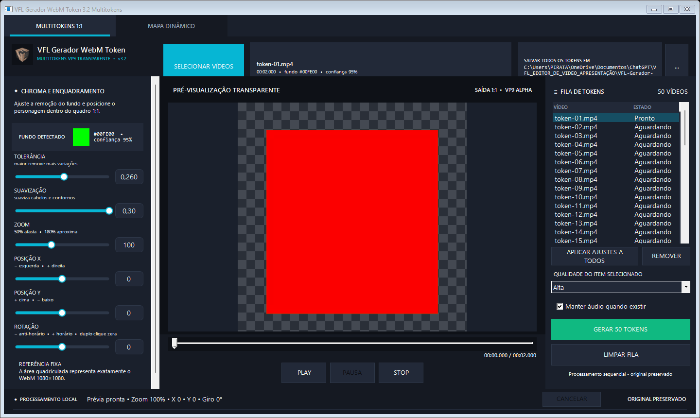
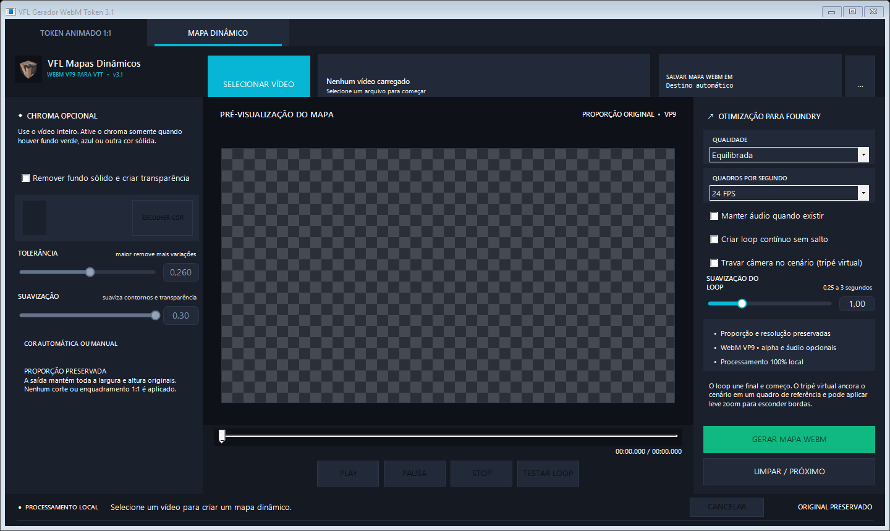

# VFL Gerador WebM Token 3.1

Aplicativo Windows para criar tokens transparentes e mapas dinâmicos **WebM VP9** otimizados para Foundry VTT.

### Token animado 1:1



### Mapa dinâmico



## Principais recursos

- Detecção automática da cor de fundo.
- Interface profissional padronizada com a suíte VFL.
- Pré-visualização transparente em referência fixa 1:1.
- Linha do tempo com precisão de milissegundos e reprodução fluida a 24 FPS, com Play, Pausa e Stop.
- Botão **Limpar / próximo** que prepara outro vídeo sem perder os ajustes.
- Preferências salvas automaticamente entre vídeos e ao fechar o programa.
- Miniatura PNG automática com o mesmo enquadramento e quadriculado da prévia.
- Remoção de fundo com máscara alfa reforçada.
- Zoom, posicionamento horizontal/vertical e rotação de `-180°` a `+180°` com atualização automática.
- Duplo clique no slider de rotação para retornar imediatamente a `0°`.
- Saída fixa em 1080×1080, 24 FPS, VP9 com alfa.
- FFmpeg 8.1 e FFprobe portáteis incluídos no pacote para Windows.
- Preset **Alpha VP9** confirmado para uso no Foundry VTT.
- Áudio opcional em Vorbis.
- Nomes sequenciais para evitar cache do Foundry.
- Processamento totalmente local; o vídeo original nunca é alterado.
- Interface escura.

## Novo na versão 3.1 — loops contínuos e estabilização

- Opção **Criar loop contínuo sem salto**, que cruza o final com o começo e deixa a repetição natural no Foundry.
- Controle de suavização do loop entre `0,25` e `3` segundos.
- Botão **Testar loop** para assistir somente à passagem final → começo antes de exportar.
- Opção **Estabilizar tremidas e pequenos saltos**, com análise de movimento em duas etapas.
- A estabilização aplica zoom adaptativo leve quando necessário para esconder as bordas criadas pela correção.
- Áudio também recebe transição suave quando o loop e a preservação de áudio estão ativados.

## Mapas dinâmicos — desde a versão 3.0

- Segunda aba dedicada a mapas, cenas, fundos e efeitos animados para VTT.
- Mantém a resolução e a proporção originais do vídeo, sem enquadramento quadrado e sem cortes.
- Chroma opcional com detecção automática de fundo verde, azul ou qualquer outra cor sólida.
- Seletor manual de cor para corrigir fundos que não forem detectados automaticamente.
- Prévia proporcional com linha do tempo, Play, Pausa e Stop.
- WebM VP9 com transparência opcional e áudio Opus opcional.
- Presets **Compacta**, **Equilibrada** e **Alta**.
- FPS original, 30, 24 ou 15 quadros por segundo.
- Exibe tamanho original, tamanho final e economia obtida.
- Configurações independentes da aba de Token.

## Requisitos

Windows 10 ou 11 de 64 bits. O pacote da seção **Releases** já inclui o FFmpeg necessário: não é preciso instalar Kdenlive, codecs ou outros programas.

## Como criar um token

1. Baixe o ZIP na seção **Releases** e extraia a pasta inteira.
2. Abra `VFL.GeradorWebMToken.exe`.
3. Selecione o vídeo com fundo sólido.
4. Confira a prévia e ajuste zoom, posições X/Y, rotação, tolerância ou suavização se necessário.
5. Clique em **Gerar WebM**.
6. Importe o novo arquivo `_TOKEN.webm` no Foundry.

## Como criar um mapa dinâmico

1. Abra a aba **Mapa Dinâmico**.
2. Selecione o vídeo do mapa, cena ou efeito.
3. Mantenha o chroma desligado para apenas otimizar o vídeo.
4. Se houver fundo sólido, ative **Remover fundo sólido** e ajuste a cor, tolerância e suavização.
5. Confira todo o vídeo pela linha do tempo.
6. Para repetição infinita, ative **Criar loop contínuo**, ajuste a suavização e use **Testar loop**.
7. Se o vídeo tiver tremidas ou pequenos saltos, ative **Estabilizar**. Deixe desligado quando quiser preservar exatamente todo o movimento original.
8. Comece com **Equilibrada + 24 FPS** e clique em **Gerar mapa WebM**.
9. Importe o arquivo `_MAPA_FOUNDRY.webm` no Foundry.

Reprodutores comuns podem mostrar o fundo verde porque não interpretam alfa em VP9. Dentro do Foundry, o fundo fica transparente.

## Configuração padrão do Token

- Tolerância: `0,260`
- Suavização: `0,30`
- Rotação: `0°`
- Qualidade: Alta (`CRF 5`)
- Bitrate: `20M`
- GOP: `15`
- Formato: `yuva420p`
- Pixels 100% transparentes armazenam RGB preto, evitando miniaturas verdes em programas que ignoram o alpha
- Áudio: Vorbis qualidade 4

## Configuração padrão do Mapa Dinâmico

- Resolução: original
- Proporção: original
- Qualidade: Equilibrada (`CRF 28`)
- FPS: 24
- Codec: VP9 com bitrate variável por qualidade
- Chroma: desligado
- Áudio: desligado; quando ativado usa Opus a 96 kbps
- Loop contínuo: desligado; suavização padrão de 1 segundo
- Estabilização: desligada

## Compilar o código

Requisitos para desenvolvimento: Windows e .NET 8 SDK. Para publicar uma distribuição completa, coloque a versão Windows compartilhada do FFmpeg 8.1 dentro de `Tools` antes de executar `dotnet publish`.

```powershell
dotnet build -c Release
dotnet publish -c Release -r win-x64 --self-contained true
```

## Licença

Uso pessoal e não comercial permitido. Venda e uso comercial são proibidos sem autorização. Este é um projeto **source-available**, não uma licença open source aprovada pela OSI.

Consulte [LICENSE.md](LICENSE.md) para os termos completos.

O FFmpeg incluído na distribuição mantém sua própria licença GPL. Consulte [FFMPEG-NOTICE.md](FFMPEG-NOTICE.md) e `THIRD-PARTY-FFMPEG-LICENSE.txt`.
